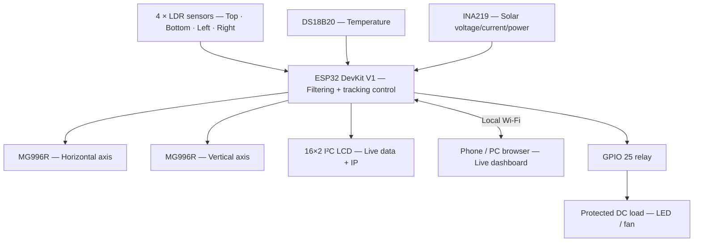

# ☀️ ESP32 Smart Dual-Axis Solar Tracking System

**LDR-Based Automatic Tracking · Real-Time Solar Monitoring · Local IoT Dashboard · Remote Load Control**

**An embedded-systems prototype that aligns a solar panel toward the brighter light source while displaying live electrical and temperature data and allowing manual load switching from a browser.**

---

## Overview

The **ESP32 Smart Dual-Axis Solar Tracking System** is a microcontroller-based renewable-energy prototype built around an **ESP32 DevKit V1**, **four light-dependent resistors (LDRs)** and **two MG996R servo motors**. The controller compares the light received from opposing sensors and adjusts the horizontal and vertical axes to reduce the detected difference.

Beyond the tracking mechanism, the prototype integrates an **INA219** for solar-side voltage/current/power readings, a **DS18B20** temperature sensor, a **16×2 I²C LCD**, and a **locally hosted web dashboard**. The dashboard displays sensor and tracking information and provides **manual ON/OFF switching of a relay-driven DC load**.

The current **V7 firmware** connects to an existing **2.4 GHz Wi-Fi network**. The LCD displays the dashboard's IP address until the browser page is opened, then resumes its measurement pages with periodic IP reminders. The system **does not create its own Wi-Fi hotspot**, **does not require a separate web login**, and **does not provide automatic battery low-voltage protection**.

---

## 📸 System Image


---

## Features

| Category                   | Implemented capability                                                                              |
| -------------------------- | --------------------------------------------------------------------------------------------------- |
| **Dual-axis movement**     | Independent horizontal and vertical MG996R servo control                                            |
| **Light sensing**          | Four 12-bit ADC inputs: top, bottom, left and right                                                 |
| **Stable tracking**        | 16-sample averaging, exponential filtering, normalized error, hysteresis and direction confirmation |
| **Position protection**    | Software angle limits and servo-position hold in invalid light conditions                           |
| **Electrical monitoring**  | INA219 solar-side voltage, current and power                                                        |
| **Temperature monitoring** | Non-blocking DS18B20 conversion                                                                     |
| **Local display**          | 16×2 I²C LCD for measurements, servo positions, tracking state and dashboard IP                     |
| **Connectivity**           | ESP32 Wi-Fi station + built-in local HTTP server                                                    |
| **Live dashboard**         | Browser view of electrical data, temperature, four LDR channels, servo angles and status            |
| **Load switching**         | Manual browser **TURN ON / TURN OFF** commands via GPIO 25 relay                                    |
| **Diagnostics**            | 115200-baud Serial Monitor output and I²C address scan at startup                                   |

---

## System Architecture



**Control path:** LDR readings → filtering → horizontal/vertical error calculation → direction confirmation → target-angle update → servo movement.

**Monitoring path:** ESP32 sensor measurements → LCD + HTTP `/api/data` → browser dashboard. Browser relay commands reach the ESP32 through HTTP `/api/load`.

---

## Hardware Requirements

| Component                                                | Quantity    | Role                                                 |
| -------------------------------------------------------- | ----------- | ---------------------------------------------------- |
| ESP32 DevKit V1                                          | 1           | Main controller and Wi-Fi server                     |
| LDR sensors                                              | 4           | Directional light sensing                            |
| Fixed resistors, initially **10 kΩ**                     | 4           | LDR voltage dividers                                 |
| MG996R metal-gear servos                                 | 2           | Horizontal and vertical positioning                  |
| Dual-axis mounting mechanism                             | 1           | Physical panel support                               |
| 6 V solar panels                                         | 2           | Series-connected solar source used in this prototype |
| INA219 sensor module                                     | 1           | Solar-side voltage/current/power measurement         |
| DS18B20 temperature sensor                               | 1           | Temperature measurement                              |
| 4.7 kΩ resistor                                          | 1           | DS18B20 DATA pull-up, if not included on module      |
| 16×2 LCD with I²C backpack                               | 1           | Local readings and network status                    |
| Single-channel relay module                              | 1           | Manual DC-load switching                             |
| Regulated **5–6 V high-current servo supply**            | 1           | Independent power for both MG996Rs                   |
| Suitable regulated controller supply                     | 1           | ESP32 and peripheral power                           |
| Compatible solar charge controller / protected battery\* | As required | Optional energy-storage setup                        |
| Wiring, appropriate fuses and mounting hardware          | As required | Safe electrical and mechanical assembly              |

*The battery and charger arrangement must be matched to the actual battery chemistry and controller specifications; a charge-management function is **not** implemented in the ESP32 firmware.*

---

## Pin Configuration

### ESP32 signal connections

| Device / signal            | ESP32 GPIO | Notes                               |
| -------------------------- | ---------- | ----------------------------------- |
| Top LDR divider output     | **34**     | ADC1, input only                    |
| Bottom LDR divider output  | **35**     | ADC1, input only                    |
| Left LDR divider output    | **32**     | ADC1                                |
| Right LDR divider output   | **33**     | ADC1                                |
| Horizontal MG996R signal   | **13**     | Servo control                       |
| Vertical MG996R signal     | **14**     | Servo control                       |
| DS18B20 DATA (DQ)          | **4**      | 4.7 kΩ pull-up to 3.3 V if required |
| LCD SDA **and** INA219 SDA | **21**     | Shared I²C bus                      |
| LCD SCL **and** INA219 SCL | **22**     | Shared I²C bus                      |
| Relay module IN            | **25**     | V7 configured as **active-HIGH**    |

### Power and electrical connections

| Module / terminal                | Connection                                                   |
| -------------------------------- | ------------------------------------------------------------ |
| Each LDR                         | 3.3 V → LDR → ADC node → 10 kΩ → GND                         |
| DS18B20 VCC / GND                | ESP32-compatible 3.3 V / common GND                          |
| INA219 VCC / GND                 | 3.3 V / compatible system ground                             |
| INA219 **VIN+**                  | Solar-panel combined positive output                         |
| INA219 **VIN−**                  | Solar charge controller **PV+** input (series positive path) |
| Solar-panel combined negative    | Solar charge controller **PV−** input                        |
| Horizontal and vertical servo V+ | **External regulated 5–6 V**, sized for both servos          |
| Both servo grounds               | External supply GND, referenced to ESP32 GND                 |
| Relay VCC / GND                  | Appropriate module supply (commonly 5 V) / common GND        |
| Relay **COM**                    | Fused, protected DC-load positive source                     |
| Relay **NO**                     | Positive input of LED / fan load; **NC unused**              |
| LED / fan negative               | Protected load-supply negative                               |

**Electrical precautions**

- Do **not** supply MG996R servos from the ESP32's 3.3 V pin or feed solar-panel voltage directly to them.
- Do **not** expose ESP32 GPIO or I²C pins to 5 V. A 5 V-only LCD backpack may require a bidirectional I²C level shifter.
- The INA219 **VIN+** and **VIN−** terminals must be connected **in series with the measured positive supply path**, never directly across solar positive/negative.
- Confirm charger grounding and isolation rules before connecting the INA219/ESP32 ground reference to the solar circuit.
- Your relay hardware must match the configured polarity (`RELAY_ACTIVE_LOW = false`); verify relay contacts and operation before connecting a load.

---

## Tracking Algorithm

The controller reads the **left/right** LDR pair for horizontal tracking and the **top/bottom** pair for vertical tracking. With the installed divider orientation, brighter light normally produces a higher ADC reading.

Normalized tracking error:

```
Horizontal Error (%) = 100 × (Left - Right) / (Left + Right)
Vertical Error (%)   = 100 × (Top - Bottom) / (Top + Bottom)
```

The firmware then filters the signals, confirms directional changes, calculates bounded target adjustments and moves the servos within configured mechanical limits.

### Control parameters in the supplied V7 firmware

| Parameter                                           | Setting                     |
| --------------------------------------------------- | --------------------------- |
| ADC resolution                                      | 12 bit (`0–4095`)           |
| Samples averaged per LDR reading                    | `16`                        |
| Exponential filter coefficient                      | `0.18`                      |
| Tracking start threshold                            | `7%`                        |
| Tracking stop threshold                             | `3%`                        |
| Direction confirmation                              | `3` consecutive detections  |
| Proportional gain (`KP`)                            | `0.18`                      |
| Maximum target-angle adjustment per tracking update | `7°`                        |
| Servo movement step                                 | Up to `3°` per servo update |
| Horizontal and vertical software limits             | `30°–180°`                  |
| Sensor polling interval                             | `60 ms`                     |
| Tracking update interval                            | `100 ms`                    |
| Servo update interval                               | `15 ms`                     |
| INA219 and LCD update intervals                     | `1000 ms`                   |
| LCD measurement-page duration                       | `4000 ms`                   |

### Light-condition handling

| Condition                                          | Firmware response                                |
| -------------------------------------------------- | ------------------------------------------------ |
| Light imbalance exceeds start threshold, confirmed | Adjust relevant servo target                     |
| Error falls inside stop threshold                  | Stop chasing small differences and hold position |
| Average light level below `120` ADC counts         | **LIGHT HOLD**                                   |
| All four LDR channels at/above `4050`              | **LIGHT HOLD** (saturation)                      |
| Light acceptable and no movement needed            | **STABLE**                                       |

> **Why saturation matters:** Four values of `4095` do not mean the light is perfectly balanced. They mean the ADC inputs have reached their measurable maximum, eliminating the directional information required for tracking.

---

## IoT Web Dashboard

The ESP32 hosts a responsive dashboard on the **local Wi-Fi network**; no cloud account, mobile application or external web service is required.

**Displayed values:**

- Solar-side voltage (**V**), current (**A**) and power (**W**)
- DS18B20 temperature (**°C**)
- Horizontal and vertical commanded servo angles (**degrees**)
- Four LDR ADC values and horizontal/vertical error
- Tracking status (`TRACKING`, `STABLE` or `LIGHT HOLD`)
- Relay command state and **TURN ON / TURN OFF** controls

**LCD network behavior:** The LCD shows **WiFi Connecting** while connecting, then the ESP32 router-assigned IP address until the dashboard opens. Afterward it returns to the normal sensor/tracking pages, displaying an IP reminder for **5 seconds every 20 seconds**. When disconnected, the LCD indicates **WiFi Not Ready**.

### Local HTTP endpoints

| Method | Endpoint    | Purpose                                              |
| ------ | ----------- | ---------------------------------------------------- |
| `GET`  | `/`         | Serve dashboard HTML                                 |
| `GET`  | `/api/data` | Return live readings and relay state as JSON         |
| `POST` | `/api/load` | Switch relay with form field `mode=on` or `mode=off` |

Example manual control request from a trusted device on the same network:

```
curl -X POST -d "mode=on" http://<ESP32_IP>/api/load
curl -X POST -d "mode=off" http://<ESP32_IP>/api/load
```

**Network security:** V7 has no separate dashboard authentication. Anyone with access to the local Wi-Fi and device IP can operate the relay. Use only a trusted, password-protected LAN; do not expose port 80 to the public internet.

---

## Software Stack

- **Arduino IDE 2.x** and **ESP32 Arduino board support**
- **Embedded C/C++** with `millis()`-scheduled periodic tasks
- **ESP32Servo** — MG996R PWM output
- **OneWire** and **DallasTemperature** — DS18B20 communication
- **Wire** — ESP32 I²C communication
- **Adafruit INA219** — electrical measurements
- **LiquidCrystal_I2C** — 16×2 LCD interface
- **WiFi** and **WebServer** — ESP32 local web dashboard (provided by the ESP32 Arduino core)

Install third-party libraries through **Arduino IDE → Library Manager**. Select a `LiquidCrystal_I2C` library version supporting `init()` and `backlight()` as used by the sketch.

---

## Getting Started

1. **Assemble the low-voltage control wiring** following the pin tables. Leave the solar/battery power path and relay load disconnected during initial firmware testing.
2. **Install the ESP32 board package** in Arduino IDE and select the correct ESP32 DevKit board and USB serial port.
3. **Install the required libraries** listed above.
4. **Open** `ESP32_Solar_Tracker_V7_Router_Only_No_Login.ino`.
5. **Enter your own private Wi-Fi credentials** in the firmware:
   ```
   constexpr const char* WIFI_SSID = "YOUR_2_4_GHZ_WIFI_NAME";
   constexpr const char* WIFI_PASSWORD = "YOUR_WIFI_PASSWORD";
   ```
6. **Verify and upload** the sketch. Open Serial Monitor at **115200 baud**. Confirm the LCD and INA219 I²C addresses are detected (commonly `0x27` or `0x3F` for LCD; `0x40` for INA219).
7. **Power the servos using a suitable external 5–6 V supply** and check horizontal/vertical movement with a controlled light source. Keep hands clear of the mechanism.
8. **Connect your phone/computer to the same 2.4 GHz Wi-Fi network**. Read the IP shown on the LCD and visit `http://<ESP32_IP>`.
9. **Check live values and manual relay switching** first with a low-risk test load. Add protected solar/charging wiring only after confirming your hardware's electrical requirements.

---

## Demonstration and Observed Results

The following values are from the prototype's previously captured Serial Monitor output; they are **not simulated efficiency or energy-yield results**.

### Indoor / controlled-light demonstration

The builder reported successful light-following motion, LCD operation, live Wi-Fi dashboard access and manual relay switching in the assembled prototype.

### Outdoor observation — LDR saturation

```
TOP:4095 BOTTOM:4095 LEFT:4095 RIGHT:4095
ERR_H:0.0 ERR_V:0.0
H:80 V:122 | TARGET_H:80.0 TARGET_V:122.0
TEMP:23.87 C | INA219 V:11.67V I:0.6mA
LIGHT HOLD
```

Outdoor measurements also showed all four LDR channels at `4095` in a shaded location. Under stronger sunlight, the INA219 displayed approximately **11.72 V** and **0.9–1.2 mA** in the shared logs. The controller correctly entered `LIGHT HOLD` rather than moving on saturated sensor data.

The low INA219 current values cannot establish solar charging performance or tracking-related power gain without a verified load, sensor wiring and controlled measurements.

## 🎥 Demonstration Video

[▶ Watch the solar tracking system demonstration on YouTube](https://youtu.be/v41nCZvpwNI)

---

## Troubleshooting

| Symptom                               | Likely cause / next check                                                                                                                         |
| ------------------------------------- | ------------------------------------------------------------------------------------------------------------------------------------------------- |
| All LDR channels show `4095` outdoors | ADC saturation; fully cover one LDR to confirm response, then test lower divider resistors (e.g. 2.2 kΩ / 1 kΩ) and a cross-shaped shadow barrier |
| `LIGHT HOLD` indoors                  | Very low average light or all-sensor saturation; inspect actual ADC readings                                                                      |
| Servo moves in the wrong direction    | Verify mechanical orientation; adjust the relevant `H_DIRECTION` or `V_DIRECTION` configuration after controlled testing                          |
| Servo jitters or ESP32 resets         | Insufficient servo supply current, voltage sag, shared power noise or weak common ground                                                          |
| `INA219 NO DATA`                      | Check device power, common reference, I²C pins and address `0x40`                                                                                 |
| LCD blank                             | Check wiring, backpack voltage/logic levels, address and contrast adjustment                                                                      |
| `WiFi Not Ready`                      | Check SSID/password, router range and 2.4 GHz compatibility; V7 has **no AP fallback**                                                            |
| Browser does not open                 | Confirm phone is on the same network and use the **current IP shown on LCD**                                                                      |
| Relay response inverted               | Verify module active-HIGH/LOW behavior, then COM/NO vs COM/NC contact wiring                                                                      |

### Outdoor LDR improvement work

Changing the LDR divider's **10 kΩ resistor to 2.2 kΩ** is a *proposed experiment*, not a verified fix. Test with one LDR first, confirm unsaturated readings outdoors, and recalibrate threshold behavior before applying it to all four sensors. Sensor shading tubes or a cross-shaped barrier can also improve directional contrast.

---

## Limitations

- Full outdoor dual-axis tracking is not yet validated because the current LDR dividers saturate in strong ambient light.
- Servo positioning is based on **commanded angles**, not an external panel-angle encoder.
- The INA219 measures the configured solar-side path; it does not directly measure battery state of charge.
- The present implementation does not include MPPT, cloud telemetry, historical data logging or automatic battery cutoff.
- The HTTP dashboard is designed for a private local network and has no separate login.
- The mechanical mount and power-supply ratings limit permissible panel size and load.

---

## Future Improvements

- Calibrate LDR dividers and optical shading for direct outdoor sunlight.
- Add validated battery-voltage sensing with chemistry-specific thresholds and a proper BMS.
- Log solar energy (`Wh`) and compare a fixed-angle panel with the tracker under controlled conditions.
- Add weatherproof housings, wind-position protection and mechanical limit switches.
- Add configurable Wi-Fi provisioning or secured remote access where justified.
- Improve monitoring with data logging, historical charts and optional cloud synchronization.

---

## Author

**Eshwar Prasad Y**

Electronics & Communication Engineering

Embedded Systems | IoT | Automotive Electronics | Arduino | Microcontrollers

**Email:** [eshwargowda313@gmail.com](mailto:eshwargowda313@gmail.com)

**LinkedIn:** [Eshwar Prasad Y](https://www.linkedin.com/in/eshwar-prasad-y-a3043b370/)

---

## Acknowledgements

Thanks to the Arduino, ESP32 and open-source embedded-systems communities, and to the developers of the libraries used in the project.

---

**☀️ ESP32 Smart Dual-Axis Solar Tracking System**

**Automatic Light Tracking · Local IoT Monitoring · Manual Web-Based Load Control**

If this project is useful, consider starring the repository ⭐
